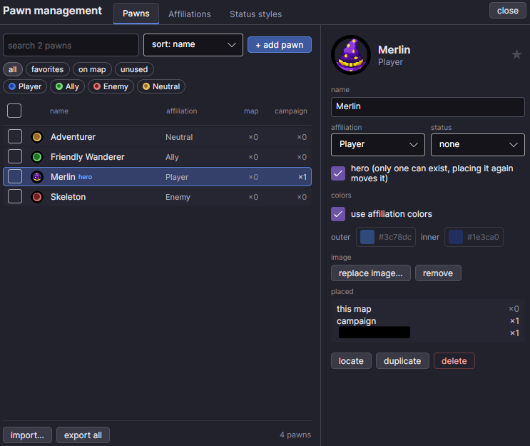
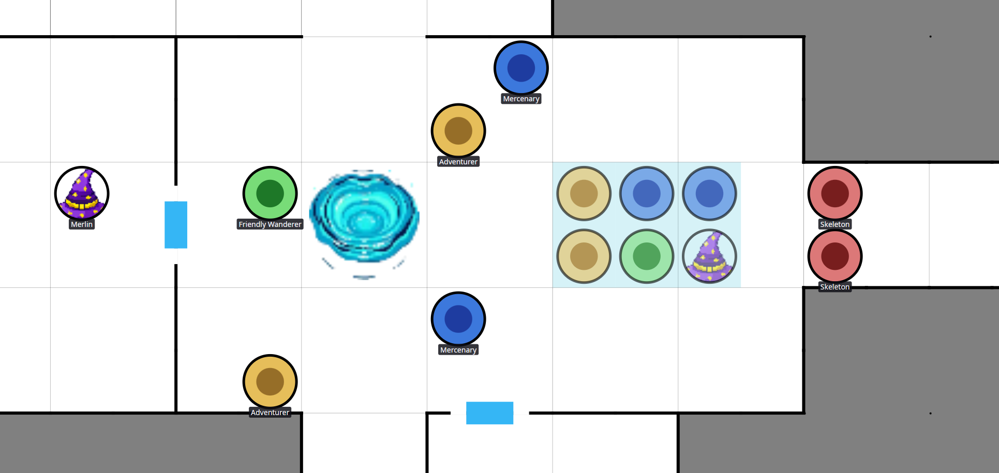
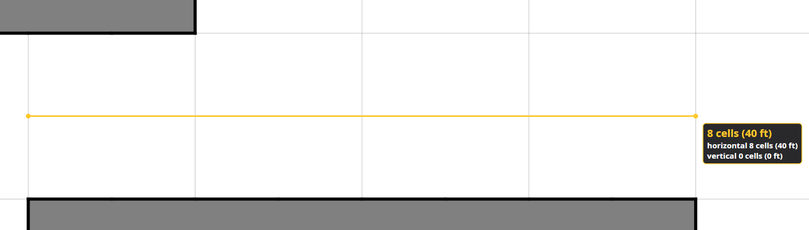
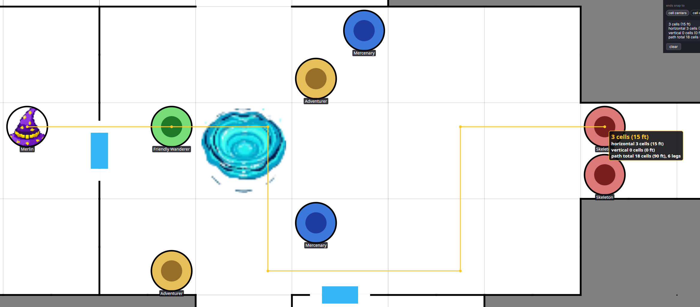
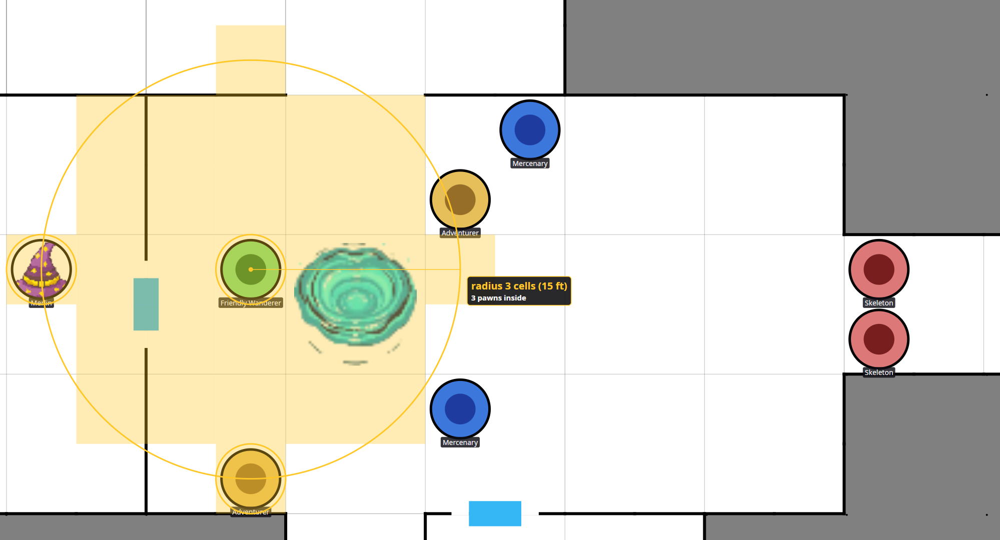

# Dungeon Mapper

A desktop dungeon mapper for old-school tabletop games. Draw rooms, walls, doors and stairs on a 5 ft grid, label them, and move pawns for your party and the things they meet. Everything runs offline on your own computer.

## Getting started

Run the `DungeonMapper` program for your system (Windows or Linux). There is nothing to install, and the app keeps its maps and settings in folders next to the program.

- **Pan:** right-click or middle-click and drag
- **Zoom:** mouse wheel
- **Pick a tool:** click it in the toolbar, or press its letter
- **Status bar:** the line at the bottom left flashes with each message. Red means something failed or was refused, orange means nothing happened (a step is missing), green means a save, export, join or host worked, and pink is a player's change during a session.

## Tools

| Tool | Key | What it does |
| --- | --- | --- |
| Select | S | Click something to edit it. Drag a pawn, object, label or image to move it (a pawn landing on another swaps them). A clicked object, label or image gets the same handles as in its own tool: drag a handle to resize. Drag on empty space, or Shift+drag from anywhere, to select an area. Drag inside the selection to move it (R or Shift+R turns it while you drag, Esc cancels), or copy, cut or paste it. **Pawns only** makes the drag move just the pawns. The clear clipboard button drops the clipboard and the paste ghost. |
| Move | M | Drag around an area, then click where it should go. Drag a single pawn to move just that pawn. Shift+drag a box to move only the pawns in it (from anywhere, even with "move pawns only" off). |
| Room | R | Drag a rectangle to make a walled room. Drawing over an existing room merges the two. |
| Polygon | N | Click grid points to outline an odd-shaped room. Click the first point again, or press Enter, to finish. |
| Floor | F | Paint floor by dragging a rectangle, or flood fill the room you click. |
| Wall | W | Press on one grid point and release on another to draw a wall line. |
| Door | D | Click a wall to place a door. Click a door to change its type or state. Close open doors shuts every open door of one type on the map in one step. |
| Stair | T | Click or drag to place stairs, then pick which way they go. |
| Label | L | Click to place a label, or drag to make one that spans an area. Click a label to edit it, drag its handles to resize it, or drag it to move it. |
| Erase | E | Remove things, and choose what the eraser takes. |
| Pawn | P | Place pawns from your library onto the map. Click a placed pawn to open it, or drag it to move it. Shift+drag a box to pick up several pawns, then click where they go (R turns them, Esc cancels). |
| Object | O | Pick an object type, such as a statue, and drag out its size on the map. Click an object to change its name or look, drag its handles to resize it, or drag it to move it. Shift+drag places one over another object. |
| Image | B | Choose a picture from your images folder, then click to place it at its own size or drag a box. Click an image to change it, drag its handles to resize it, or drag it to move it. See [Images](#images). |
| Measure | G | Drag to measure a distance, or Shift+drag for a spell radius. See [Measuring](#measuring). |
| Sight | K | Shows what a pawn can see, and what it could shoot past other pawns. See [Line of Sight](#line-of-sight). |
| Reveal | H | Chooses what players will see: reveal or hide floor, mark items DM only. See [Reveal](#reveal). |

You can change the tool letters, and the zoom to fit key, in the hotkeys menu.

## Other shortcuts

| Keys | Action |
| --- | --- |
| Z | Zoom to fit |
| I | Deploy the last formation you used |
| \ (backslash) | Ping the cell under the cursor (see [sessions](#playing-together-sessions)) |
| Ctrl+S | Save |
| Ctrl+Z / Ctrl+Y | Undo / redo |
| Ctrl+C / Ctrl+X / Ctrl+V | Copy, cut, paste at the cursor |
| R / Shift+R | Rotate what you are pasting or moving |
| Ctrl+F | Search pawns |
| Delete | Delete the item you clicked, or, with a region selected, choose what in it to delete |
| Shift+Delete | Delete everything in the selected region, without asking |
| Esc | Cancel what you are doing, or close a menu |

## Campaigns and maps

A save file is a campaign. One campaign can hold many maps, such as one per dungeon level. Switch between them from the toolbar, and use the maps menu to add, rename, reorder, export or delete them. You can also bring a map in from another file.

Each campaign has its own:

- **Door types:** named door colors, such as locked or secret.
- **Pawn statuses:** rings drawn around a pawn, such as poisoned or asleep. A pawn can have several: its ring splits into one colored arc per status, with a small gap between them (the **pawn status gap** setting, in degrees).
- **Affiliations:** pawn colors by side, such as party or enemy.

Any of these can be exported, and they can be imported from another campaign or map file. Importing only adds names you don't have yet. It never changes the ones you already made.

## Pawns

Pawns are tokens for characters and monsters. Each one can have a name, a picture and an affiliation color. Statuses belong to each pawn on the map, not to the pawn type: click a placed pawn and use **add status** to pick from a searchable menu (as many as you like; each click adds one and the menu stays open), and new pawns start with none. The ✕ beside a status removes it. Your pawn library lets you search, sort, mark favorites and quickly reach recently used pawns. In pawn management (Manage, Pawns) the list is grouped by affiliation under headers you can click to fold or unfold; the tick on a header selects that whole group, and the **all / favorites / on map / unused** chips filter the list. A pawn marked as a hero can only appear once in the campaign, and placing it again moves it. The library can be exported and imported too.

### Formations

A formation saves where a group of pawns stand relative to each other, such as your party's marching order. In the pawn panel, use **+ new** under formations and drag a box around the pawns on the map, then type a name.

Click **deploy** and the formation follows the cursor as a ghost. R or Shift+R turns it, and a click places everyone in one step. Heroes move there from wherever they are, even another map, and keep their status. Other pawns get a new copy. If another pawn is in the way, that cell turns red and nothing is placed until you move the ghost. Landing outside a room is allowed with a warning. Esc cancels.

Click a formation to open it. Tick or untick members to leave someone out (all, none and heroes chips, skip by status, and groups by affiliation help with big formations). You can also rename it, update it from a new area, or delete it. By default, `I` deploys the last formation you used.

### Turn tracking

Each status on a pawn has a **turns** box: how many turns it has left, or -1 for permanent. Adding a status fills in its default, set in the **turns** column of the statuses tab in pawn management (-1 unless you change it).

Click **start combat** at the bottom left to start counting turns on the open map. **Pass turn** counts every timed status down by one; one that reaches 0 is removed and "<status> wore off!" floats up over the pawn. Heroes count down wherever they are. **End combat** removes every timed status (permanent ones stay) and hides the counter. Each of these is one undo step. Pass turn can also have a hotkey (unset by default, in the hotkeys menu).

A status's arc on the pawn's ring runs down with its turns: full at 6 or more turns left (and for permanent statuses), then a sixth shorter each turn, keeping its start and pulling back its end.

When you zoom in close, each status on a pawn gets a small circle in its color beside the ring with the turns it has left (99+ past 99). A permanent status shows ∞, or no circle if you turn **timers for permanent statuses** off in settings; **status turn timers** shows them on every pawn, or with **hover only** just on the pawn under the mouse (any tool), and **timer distance** sets how far out they sit (0% on the ring, 50% just touching it, 100% clear of it). With names on, a pawn's name sits inside its circle, low down, out of the timers' way. In a session, players see the turn number and the "wore off" text, but only the DM runs the turns.

## Objects

Objects are things in a room that take up space, such as statues, paintings or reliefs. Like pawns, you make the types first in the objects menu (Manage, Objects), then place them. One type can be placed at any size, so one statue can be 5x5 ft and another 10x15 ft.

Each type has a look: a solid color, a gradient, a radial fade, stripes, a checker, an outline, or a picture. It can also have a border, with its own color and thickness, and show its name or initials. A picture is saved once in the campaign file however many objects use it. Pictures can be PNG, JPG, WEBP, GIF or BMP, and transparent parts show the map through unless you pick a fill color to go behind them. A placed object uses its type's look unless you turn off "use the type's look" for it and give it its own. A placed object can also have its own name.

The object panel lists your types with how many are on the map and a button that jumps to each one. The select, move, copy and paste, rotate and erase tools work on objects too. Rotating swaps an object's width and height. The eraser removes any object it touches when "objects" is on.

## Images

The image tool puts pictures on the map: room art, a handout, a painted floor. Pictures are never saved in the map file. The map keeps only which file it is (its place in the images folder plus a fingerprint of its content), so maps stay small and the same picture can be used anywhere.

- **Images folder:** set it in settings (Images). Point it at the folder your group shares, for example a shared drive. Each computer picks its own path to it, so drive letters do not matter. A settings import keeps this computer's folder.
- **Placing:** choose a picture (PNG, JPG, WEBP, GIF or BMP). A picture from outside the images folder can be copied into it, since the other computers could not find it otherwise. A click places it at its own size (100 picture pixels per 5 ft cell); a drag places it in the box you drag. The panel lists the pictures already on the map, click one to place more.
- **An image's view:** **fit** shows all of the picture, **fill** covers the box and crops what does not fit, **stretch** fills the box exactly. **Keep shape while resizing** (on for new images) keeps the box close to the picture's proportions when you drag the handles. **Turn left / right**, **picture size** (back to its own size), **replace picture**, **place more** and delete. The **hidden / visible** badge by the title flips whether players see it.
- If a picture is renamed or moved inside the folder, it is still found by its fingerprint. A picture that can not be found, or a computer with no images folder, shows a dashed box with the file name, which you can still move, resize or delete. **Reload pictures** in the panel picks up files that changed.
- In a session, an image is shown to players unless it is DM only. Unlike other items it does not need revealed floor under it, so handouts beside the map work.
- Images draw over doors and under labels and pawns. Select, move, copy and paste, rotate (which turns the picture too), erase ("images" filter) and the reveal tool work on them.

## Measuring

The measure tool only reads the map. It never changes anything, adds an undo step or counts as an unsaved change. Distances show in cells and feet (5 ft per cell).
- Ends snap to cell centers. The "cell corners" chip in the side panel snaps them to grid corners instead.
- A measurement stays on screen until you press Esc, switch tools, start a new one or click **clear**. The color and shading strength are in settings.

- **Distance:** drag between two points. The readout shows the straight line distance and its horizontal and vertical parts.

- **Waypoints:** Ctrl+click or Ctrl+drag adds another leg from the end of the line. The readout shows the current leg and the path total.

- **Spell radius:** Shift+drag from any spot, a pawn included. The radius snaps to whole cells and ignores walls. Cells whose center is inside the circle are shaded, and the pawns in them get a ring. The side panel lists those pawns by affiliation.

- **Pawn to pawn:** drag from one pawn onto another to get the distance between them (with the centers chip on).

## Line of Sight

The sight tool shows everything a pawn can see. It is for the DM only: players in a session can not use it and never see it.

- Click a pawn to see from it. Click an empty cell to see from there, as if a pawn stood on it. Sight is from the center of the cell.
- What it can see is tinted **green**. Behind one pawn is **orange** (you can shoot over one pawn), behind two or more is **red**. Every pawn counts, whoever's side it is on. The shading is exact, so a cell that is partly visible is partly shaded.
- Walls, closed and locked doors (DM only doors too) and the edge of the floor block sight. Open doors and stairs do not. Objects are ignored: some block and some do not, so judge those yourself.
- Everything it can not see is dimmed.
- Hover over a cell for a line to its center, labelled clear, 1 pawn in the way, 2 pawns in the way, blocked or out of range.
- Drag a pawn with the tool to move it (one undo step, like the move tool). The sight follows the pawn while you drag, so you can find where it needs to stand.
- The **range** slider runs from 5 to 240 ft in 5 ft steps, starting at 120 ft. Type any value from 1 to 240 in the box under it. Shift+scroll changes it too. It is kept until you close the app.
- Opening a door, moving a pawn or undoing updates it straight away. Esc or a tool switch clears it. Nothing is saved.
- The three colors, how strong the tint is (30 percent by default) and how dark the dimming is (40 percent by default, in the dim color) are in settings.

## Reveal

The reveal tool marks what players are allowed to see. It is the groundwork for multiplayer, where the DM hosts and players only ever receive what has been revealed. Every change is one undo step and is saved with the map.

- **Cells** shows or hides floor. **Box** drags a rectangle (a click is one cell), **room** fills the room you click up to its walls (doors count as walls), and **circle** drags out from a center. **Reveal whole map** and **hide whole map** do every floor cell at once.
- **Items** marks labels, doors, objects, pawns and images **visible** or **DM only** with a box. Tick which kinds the box changes. A DM only item is never shown to players, even on revealed floor.
- New items start DM only, except pawns with the **Player** affiliation, which start visible. Maps made before this tool load with every item visible and nothing revealed.
- Each door, label, pawn, object and image view shows a badge by its title: pink **hidden** (DM only) or grey **visible**. Click it to flip.
- While the tool is selected, hidden floor is dimmed (using the dim color and darkness from settings) and DM only items have a dashed pink outline.
- **View > Player view preview** (or the button in the reveal panel) shows exactly what players would be sent: revealed floor, the walls and doors around it, and the visible items on it. Nothing can be edited while it is on; panning, zooming, saving, undo and redo still work. Esc or picking a tool returns to editing.

## Playing together (sessions)

The DM can host a session for players on the same network (home wifi or LAN). Players see only what the DM reveals with the [reveal tool](#reveal); hidden rooms, DM only items and anything they use (secret door types, hidden monsters' pawns) never leave the DM's computer. Only the DM can save. Players can move, place and set the status of Player pawns, keep formations of them, and add and edit labels players may edit; everything else only the DM changes.

- **Host:** Session > Host a session. Give it a name, an optional code players must type, and pick the **map shown to players**. That pick is separate from the map you have open, so you can prepare the next level while players stay on the current one. The window shows the address players join at and who has joined. Every reveal, door you open or pawn you move reaches players within a moment.
- **Join:** Session > Join a session. Sessions on your network are listed; click one to join, or type the address and port the DM's window shows. Your name, the address, port and code of the last session you joined are filled in next time (kept on this computer, not in settings exports). Both computers need the same Dungeon Mapper version.
- **While joined** you see the DM's map read only, with the measure tool and panning and zooming. Your own campaign is untouched and comes back when you leave (Session > Leave session) or the DM stops hosting.
- **Your pawns:** pawns with the **Player** affiliation (hero or not) belong to the players. The **pawn** tool shows the DM's pawn menu cut down to Player pawns: search, all / on map, names on map, formations and the list with counts and find buttons. Click a pawn, then an empty revealed floor cell to place it (a hero already on this map moves there and keeps its status; a hero the DM has hidden, or on another map, can not be placed). Click a placed Player pawn to add or remove its statuses. The **move** and **pawn** tools drag Player pawns, and Shift+drag a box to move several at once (click where they go, R turns them) to empty revealed floor. **Formations** work as for the DM, with Player pawns only: + new and update from area capture them, rename, delete, and deploy with the member checklist (r / shift+r rotates, I deploys the last one). Every change goes to the DM's app, lands on the real map (formations in the DM's campaign) as an undo step and shows for everyone. Ally, Enemy and Neutral pawns, and DM formations with them, only the DM touches. A refused change says why in the status bar.
- **Managing your pawns:** the **manage** button in the pawn panel opens the pawn management window with only Player pawns. Players can add pawns (always Player pawns), duplicate them, and change their name, colors and image. The affiliation and the hero mark stay the DM's, and players never delete a pawn type (ask the DM). There are no affiliation or status style tabs, no import or export, and no counts from the DM's other maps. Changes go to the DM's campaign (typing is sent after a short pause) and show for everyone.
- **Labels:** joined players have the **label** tool. A label a player adds goes onto the DM's map for everyone (and is saved in the DM's file), marked with the player's name; it shows to players wherever it is. Any player can change (text, size, alignment, color, resize) or delete labels that players can edit; the DM's own labels stay the DM's. The DM's label view has a **players can edit** checkbox to hand any label over or take one back, and shows which player made a label. Each player change is one undo step for the DM.
- **Images:** joined players have the **image** tool and use their own images folder. Any player can place images, and change or delete any image that is not DM only. Each change is one undo step for the DM. A DM only image is never sent to players (the shared folder itself is not hidden from them).
- **Ping:** press backslash (changeable in the hotkeys menu, which now also takes digits and keys like [ ] ; ,) to ping the cell under the cursor. Everyone else in the session sees rings on it and a note at the top right, "Ana pinged 12,7", with a **jump** button. The DM's pings go to the map shown to players, so the DM pings from that map.
- The status bar shows the session on the right. The first time you host, your firewall may ask to allow Dungeon Mapper; allow it on private networks. Sessions use port 47320 (TCP) and 47321 (UDP, for the list of sessions).

## Saving and safety

- **Save:** Ctrl+S saves over the file you opened. A new campaign asks where to save it the first time.
- **Autosave:** the app saves a copy every few minutes. You can set the interval in settings. Autosaves go in `maps/autosaves`. Nothing is written when nothing has changed since the last save or autosave.
- **Exiting:** closing the app with unsaved changes asks whether to save first. Esc cancels.
- **Backups:** whenever you open a file, an untouched copy goes into `maps/backups` first.
- **Undo:** almost every change can be undone.

## Settings

The settings menu covers grid spacing and colors, how strong the grid lines inside rooms are, map colors, wall thickness, how much wall is cleared next to a door, the sight tool's colors and dimming, whether to draw with the CPU instead of the graphics card (for a computer where the map goes blank; needs a restart and is never exported), the default label text, the autosave interval and the images folder. Settings belong to the app, not to a campaign, and can be exported to a file and imported again on another computer.
