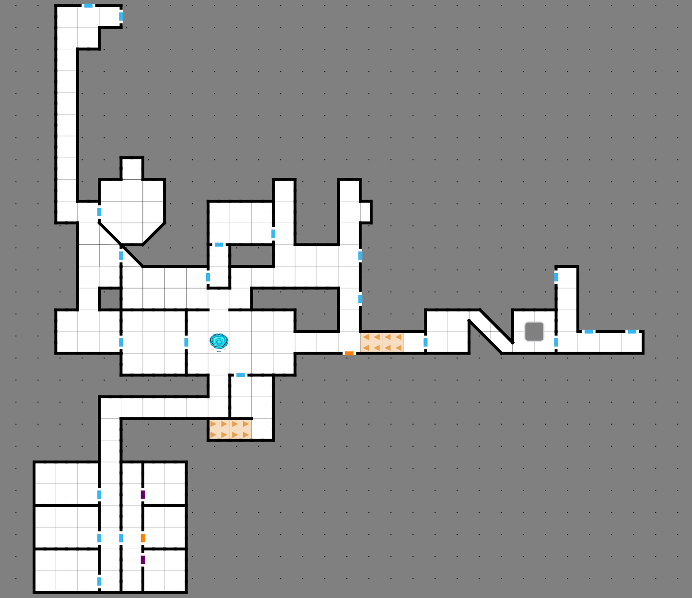
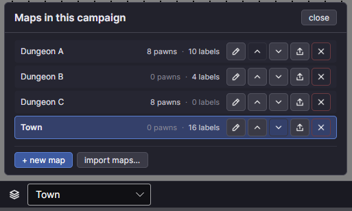
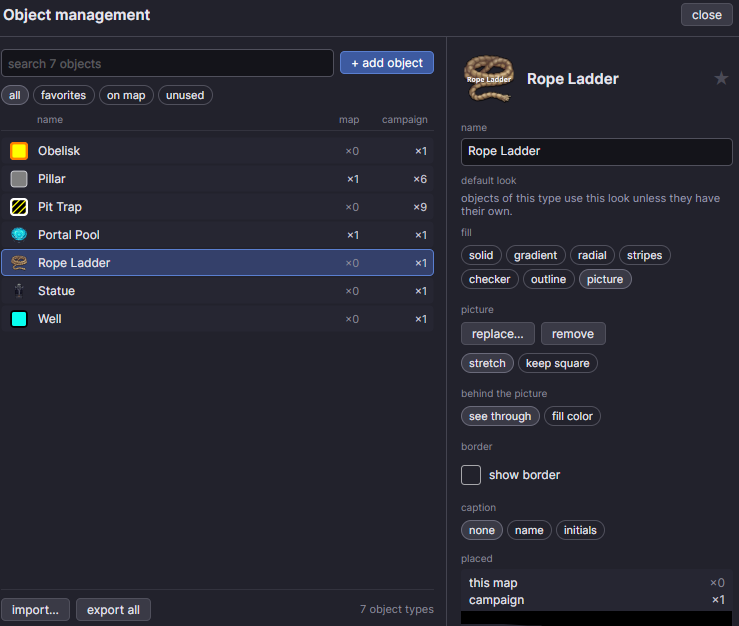
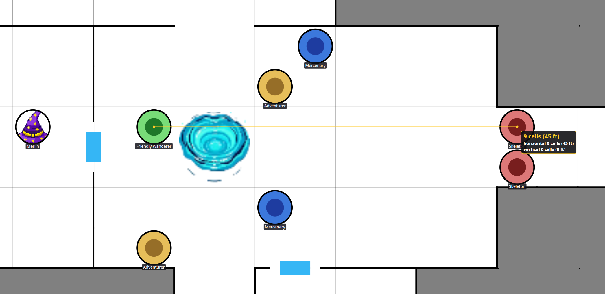

# Dungeon Mapper

A desktop dungeon mapper for old-school tabletop games. Draw rooms, walls, doors and stairs on a 5 ft grid, label them, and move pawns for your party and the things they meet. Everything runs offline on your own computer.

## Getting started

Run the `DungeonMapper` program for your system (Windows or Linux). There is nothing to install, and the app keeps its maps and settings in folders next to the program.

- **Pan:** right-click and drag
- **Zoom:** mouse wheel
- **Pick a tool:** click it in the toolbar, or press its letter

## Tools

| Tool | Key | What it does |
| --- | --- | --- |
| Select | S | Click something to edit it. Drag to select an area, then copy, cut or paste it. The clear clipboard button drops the clipboard and the paste ghost. |
| Move | M | Drag around an area, then click where it should go. Drag a single pawn to move just that pawn. |
| Room | R | Drag a rectangle to make a walled room. Drawing over an existing room merges the two. |
| Polygon | N | Click grid points to outline an odd-shaped room. Click the first point again, or press Enter, to finish. |
| Floor | F | Paint floor by dragging a rectangle, or flood fill the room you click. |
| Wall | W | Press on one grid point and release on another to draw a wall line. |
| Door | D | Click a wall to place a door. Click a door to change its type or state. Close open doors shuts every open door of one type on the map in one step. |
| Stair | T | Click or drag to place stairs, then pick which way they go. |
| Label | L | Click to place a label, or drag to make one that spans an area. Click a label to edit it, and drag its handles to resize it. |
| Erase | E | Remove things, and choose what the eraser takes. |
| Pawn | P | Place pawns from your library onto the map. |
| Object | O | Pick an object type, such as a statue, and drag out its size on the map. Click an object to change its name or look, and drag its handles to resize it. Shift+drag places one over another object. |
| Measure | G | Drag to measure a distance, or drag out from a pawn for a spell radius. See [Measuring](#measuring). |
| Fog | V | Dims the map outside a vision radius to show how far a character can see. See [Fog](#fog). |

You can change the tool letters, and the zoom to fit key, in the hotkeys menu.

## Other shortcuts

| Keys | Action |
| --- | --- |
| Z | Zoom to fit |
| I | Deploy the last formation you used |
| Ctrl+S | Save |
| Ctrl+Z / Ctrl+Y | Undo / redo |
| Ctrl+C / Ctrl+X / Ctrl+V | Copy, cut, paste at the cursor |
| R / Shift+R | Rotate what you are pasting or moving |
| Ctrl+F | Search pawns |
| Delete | Erase the selection |
| Esc | Cancel what you are doing, or close a menu |

## Campaigns and maps

A save file is a campaign. One campaign can hold many maps, such as one per dungeon level. Switch between them from the toolbar, and use the maps menu to add, rename, reorder, export or delete them. You can also bring a map in from another file.

Each campaign has its own:

- **Door types:** named door colors, such as locked or secret.
- **Pawn statuses:** rings drawn around a pawn, such as poisoned or asleep.
- **Affiliations:** pawn colors by side, such as party or enemy.

Any of these can be exported, and they can be imported from another campaign or map file. Importing only adds names you don't have yet. It never changes the ones you already made.

## Pawns

Pawns are tokens for characters and monsters. Each one can have a name, a picture, an affiliation color and a status. Your pawn library lets you search, sort, mark favorites and quickly reach recently used pawns. A pawn marked as a hero can only appear once in the campaign, and placing it again moves it. The library can be exported and imported too.

### Formations

A formation saves where a group of pawns stand relative to each other, such as your party's marching order. In the pawn panel, use **+ new** under formations and drag a box around the pawns on the map, then type a name.

Click **deploy** and the formation follows the cursor as a ghost. R or Shift+R turns it, and a click places everyone in one step. Heroes move there from wherever they are, even another map, and keep their status. Other pawns get a new copy. If another pawn is in the way, that cell turns red and nothing is placed until you move the ghost. Landing outside a room is allowed with a warning. Esc cancels.

Click a formation to open it. Tick or untick members to leave someone out (all, none and heroes chips, skip by status, and groups by affiliation help with big formations). You can also rename it, update it from a new area, or delete it. By default, `I` deploys the last formation you used.

## Objects

Objects are things in a room that take up space, such as statues, paintings or reliefs. Like pawns, you make the types first in the objects menu (Manage, Objects), then place them. One type can be placed at any size, so one statue can be 5x5 ft and another 10x15 ft.

Each type has a look: a solid color, a gradient, a radial fade, stripes, a checker, an outline, or a picture. It can also have a border, with its own color and thickness, and show its name or initials. A picture is saved once in the campaign file however many objects use it. Pictures can be PNG, JPG, WEBP, GIF or BMP, and transparent parts show the map through unless you pick a fill color to go behind them. A placed object uses its type's look unless you turn off "use the type's look" for it and give it its own. A placed object can also have its own name.

The object panel lists your types with how many are on the map and a button that jumps to each one. The select, move, copy and paste, rotate and erase tools work on objects too. Rotating swaps an object's width and height. The eraser removes any object it touches when "objects" is on.

## Measuring

The measure tool only reads the map. It never changes anything, adds an undo step or counts as an unsaved change. Distances show in cells and feet (5 ft per cell).
- Ends snap to cell centers. The "cell corners" chip in the side panel snaps them to grid corners instead.
- A measurement stays on screen until you press Esc, switch tools, start a new one or click **clear**. The color and shading strength are in settings.

- **Distance:** drag between two points. The readout shows the straight line distance and its horizontal and vertical parts.

- **Waypoints:** Ctrl+click or Ctrl+drag adds another leg from the end of the line. The readout shows the current leg and the path total.

- **Spell radius:** drag out from a pawn, or Shift+drag from any spot. The radius snaps to whole cells and ignores walls. Cells whose center is inside the circle are shaded, and the pawns in them get a ring. The side panel lists those pawns by affiliation.

- **Pawn to pawn:** drag from one pawn onto another to get the distance between them.

## Fog of War

The fog tool shows how far a character can see. Like the measure tool it only reads the map: nothing changes, no undo step, nothing saved.

- With the tool selected the whole map is dimmed, except the cells within the vision radius. Cells whose center is inside the circle are revealed. Walls are ignored.
- The center follows the cursor and snaps to the closest cell center or grid corner. Anywhere on a pawn's cell snaps to the pawn.
- Click to anchor the center. Click somewhere else to move it. Esc or **release anchor** goes back to following the cursor.
- The **vision radius** slider runs from 0 to 120 ft in 10 ft steps, starting at 30 ft. Shift+scroll changes it too. It is kept until you close the app.
- The **fog on** checkbox turns the dimming off without leaving the tool. The fog never shows with another tool selected, and picking the tool again turns it back on.
- The fog color (black by default) and how dark it is (30 percent by default) are in settings.

## Saving and safety

- **Save:** Ctrl+S saves over the file you opened. A new campaign asks where to save it the first time.
- **Autosave:** the app saves a copy every few minutes. You can set the interval in settings. Autosaves go in `maps/autosaves`. Nothing is written when nothing has changed since the last save or autosave.
- **Exiting:** closing the app with unsaved changes asks whether to save first. Esc cancels.
- **Backups:** whenever you open a file, an untouched copy goes into `maps/backups` first.
- **Undo:** almost every change can be undone.

## Settings

The settings menu covers grid spacing and colors, how strong the grid lines inside rooms are, map colors, wall thickness, how much wall is cleared next to a door, the default label text and the autosave interval. Settings belong to the app, not to a campaign, and can be exported to a file and imported again on another computer.
